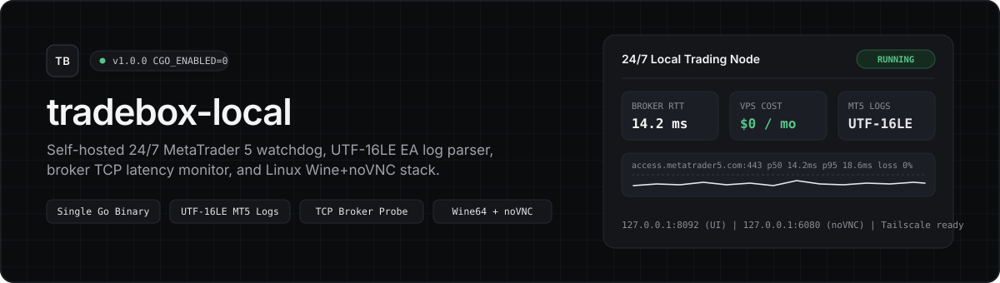
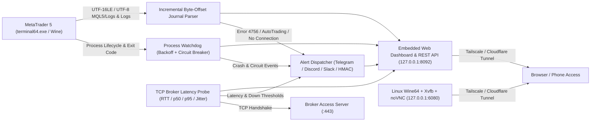

<p align="center">
  
</p>

# tradebox-local

I built `tradebox-local` after running into the same friction most independent MQL5 developers, students, and hobbyist algo-traders hit: keeping MetaTrader 5 (`terminal64.exe`) and a couple of Expert Advisors online 24/7 usually pushes you toward a `$20-$60/mo` Windows Forex VPS. If you do not have an international credit card, a `.edu` student cloud grant, or the desire to pay recurring Windows Server license fees just to run one trading terminal, a spare laptop on your desk or a cheap Linux Docker host is already more than enough hardware.

The missing piece on personal hardware is reliable operational plumbing: restarting MT5 cleanly when it crashes or disconnects, actually reading MT5's native UTF-16LE `MQL5/Logs/*.log` files without mangled null bytes, measuring real TCP execution latency to your broker server, sending crash/order-error alerts to Telegram or Discord, and running MT5 inside Linux Wine + browser noVNC when you do not want Windows at all.

`tradebox-local` packages all of that into a **single zero-dependency Go binary (`CGO_ENABLED=0`)** paired with a **Linux Wine64 + noVNC Docker Compose stack** and an embedded minimalist Light/Dark Web Dashboard.

---

## Live Recovery Flow

<p align="center">
  
</p>

> Optional screen-capture slot: if you record a local terminal capture for your own fork, drop it at `assets/demo.gif`.

---

## Architecture



---

## What It Includes

- **Cross-Platform 24/7 Process Watchdog (`internal/watchdog`)**: Supervises `terminal64.exe`, `wine terminal64.exe`, or any custom trading bot. Automatically recovers unexpected exits with capped exponential backoff (`1s -> 2s -> 4s -> 8s ...`), tracks current/total uptime, PID, and exit codes, and trips a crash-loop circuit breaker if restarts exceed `max_restarts_per_hour`.
- **Native MetaTrader 5 UTF-16LE & UTF-8 Log Parser (`internal/journal`)**: Automatically detects and decodes UTF-16LE (with `0xFF 0xFE` BOM or BOM-less) and UTF-8 files across `Logs/` and `MQL5/Logs/`. Tracks per-file byte offsets (including odd-byte partial write boundaries and daily log rotation) so tailing uses constant memory and never duplicates alerts.
- **Broker TCP Execution Latency Monitor (`internal/latency`)**: Measures real TCP handshake RTT (`ms`) against every configured broker server, computing rolling `last`, `min`, `p50`, `p95`, `max`, `jitter`, and `loss %` with an inline SVG sparkline and threshold alerting.
- **Multi-Channel Alert Dispatcher (`internal/alerts`)**: Pure-Go `net/http` delivery to Telegram (`sendMessage`), Discord (Embeds), Slack (Block Kit), and Generic HMAC-SHA256 signed webhooks (`X-TradeBox-Signature: sha256=...`) with per-rule cooldown anti-storm throttling.
- **24/7 Home-Laptop Readiness Checker (`internal/power`)**: Inspects OS, CPU cores, RAM, and Wine/container state, and prints safe, non-destructive keep-awake commands (`powercfg` lid-closed AC profile on Windows, `systemd-inhibit` on Linux, `caffeinate` on macOS).
- **Embedded Light/Dark Dashboard (`internal/web`)**: Single-binary `embed.FS` web UI with zero external CDN requests, 1-click `Start` / `Restart` / `Stop`, remote noVNC launch link, broker latency sparklines, live filtered MT5 log stream, alert test button, host readiness guide, and community plugins view.
- **Linux Wine64 + noVNC Docker Stack (`docker/`)**: Multi-stage Debian + Wine64 + Xvfb + Fluxbox + x11vnc + noVNC container with `tradebox` supervising MT5 on any Linux host — no Windows license required.

---

## Three Practical $0 / Self-Hosted Deployment Paths

| Hosting Path | Monthly Infra Cost | Setup Complexity | Best For |
| --- | --- | --- | --- |
| **1. Spare Windows/Linux Laptop at Home + Tailscale** | `$0/mo` (existing hardware + home internet) | Low (single binary) | Running native `terminal64.exe /portable` with lid closed on AC power (`tradebox host-check`) and private mobile/remote checks over Tailscale. |
| **2. Linux Mini-PC / Old Desktop + Docker Wine64 + noVNC** | `$0/mo` (existing Linux box) | Low (`docker compose up -d`) | Headless Linux machines where you want MT5 isolated in a container with browser remote desktop on `127.0.0.1:6080` and watchdog UI on `127.0.0.1:8092`. |
| **3. Low-Cost Linux Host vs Managed Windows Forex VPS** | `$4-$6/mo` Linux box vs `$25-$60/mo` Windows Forex VPS | Medium (Docker + Wine64) | Traders who want datacenter uptime closer to broker servers without paying Windows Server licensing markups. |

---

## Quickstart

### Option A: Single Binary (Windows / Linux / macOS)

Download the pre-built static binary from [GitHub Releases](https://github.com/xity4uu-a11y/tradebox-local/releases/tag/v1.0.0) (or build locally with Go 1.22+):

```bash
# Build locally (zero CGo / OpenSSL dependencies)
CGO_ENABLED=0 go build -trimpath -o tradebox ./cmd/tradebox

# 1. Generate tradebox.json and a sample UTF-16LE MT5 log fixture
./tradebox init --config tradebox.json

# 2. Check 24/7 laptop readiness and print OS keep-awake commands
./tradebox host-check

# 3. Measure live TCP latency to your broker access server
./tradebox probe --host access.metatrader5.com --port 443 --count 5

# 4. Decode and inspect the sample UTF-16LE MT5 journal
./tradebox parse-log ./mt5-logs/MQL5/Logs/$(date +%Y%m%d).log --filter errors

# 5. Start the watchdog daemon and embedded web dashboard
./tradebox serve --config tradebox.json --addr 127.0.0.1:8092
```

Open `http://127.0.0.1:8092` in your browser.

### Option B: Linux Docker + Wine64 + noVNC Stack

Run MetaTrader 5 on any Linux machine without a Windows license:

```bash
# Start Wine64 + Xvfb + Fluxbox + noVNC + TradeBox Watchdog
docker compose up -d --build
```

- **TradeBox Watchdog Dashboard**: `http://127.0.0.1:8092`
- **noVNC Browser Remote Desktop**: `http://127.0.0.1:6080/vnc.html?autoconnect=1&resize=scale`
- **Persistent MT5 Volume**: `./mt5-data` (stores Wine prefix, `terminal64.exe`, Expert Advisors, and `MQL5/Logs/` across container restarts)

By default, `docker-compose.yml` binds ports `6080` and `8092` strictly to `127.0.0.1` on the host so you never expose public RDP or VNC ports to the internet.

#### Remote Access Without Opening Firewall Ports

Pair `tradebox-local` with a private overlay tunnel:

- **Tailscale**: Install Tailscale on your host and phone/laptop, then expose the local dashboard privately via `tailscale serve https / http://127.0.0.1:8092` (or access over your private Tailnet).
- **Cloudflare Tunnel**: Run `cloudflared tunnel --url http://127.0.0.1:8092` protected by Cloudflare Access email/OTP authentication.

### Option C: Zero-Dependency Node 1-Click Initializer

Scaffold `tradebox.json`, `.env.example`, and a UTF-16LE sample MT5 log for either laptop or Docker mode:

```bash
# Preview without touching disk
node bin/create-tradebox-local.mjs --dry-run

# Initialize a home-laptop profile in ./my-mt5-node
node bin/create-tradebox-local.mjs --mode laptop --dir ./my-mt5-node --broker-host access.metatrader5.com --broker-port 443
```

---

## MetaTrader 5 UTF-16LE Log Parser Guide

On Windows and Wine, MetaTrader 5 writes daily journal files (`YYYYMMDD.log` inside `Logs/` and `MQL5/Logs/`) in **UTF-16LE with a `0xFF 0xFE` BOM**. Standard Unix tools like `tail -f` or `grep` frequently misread these files because every ASCII character is interleaved with `0x00` bytes.

`tradebox-local` handles this natively:

1. Detects UTF-16LE with BOM (`FF FE`), BOM-less UTF-16LE (odd-index null-byte heuristic), UTF-16BE (`FE FF`), and UTF-8.
2. Preserves 2-byte UTF-16 alignment across incremental reads so mid-flush odd-byte boundaries never corrupt lines.
3. Resets offsets automatically on daily log rotation or truncation.
4. Classifies operational MT5 events into `severity` (`info | warn | error | trade`) and `category` (`connection | autotrading | order | ea_error | journal`), specifically catching:

| Rule ID | Severity | Category | Matched MT5 Patterns |
| --- | --- | --- | --- |
| `mt5_error_4756` | `error` | `order` | `Error 4756`, `retcode 10006`, `retcode 10018` |
| `mt5_ordersend_failed` | `error` | `order` | `OrderSend failed`, `failed instant`, `failed market` |
| `mt5_autotrading_disabled` | `error` | `autotrading` | `AutoTrading disabled`, `automated trading is disabled` |
| `mt5_no_connection` | `error` | `connection` | `No connection`, `connection lost`, `disconnected` |
| `mt5_common_error` | `error` | `ea_error` | `Common error`, `array out of range`, `zero divide` |
| `mt5_not_enough_money` | `error` | `order` | `Not enough money`, `insufficient margin` |
| `mt5_invalid_stops` | `error` | `order` | `Invalid stops`, `invalid sl/tp` |
| `mt5_trade_context_busy` | `warn` | `order` | `Trade context is busy` |
| `mt5_requote` | `warn` | `order` | `Requote`, `off quotes`, `price changed` |
| `mt5_trade_filled` | `trade` | `order` | `filled`, `deal #`, `position opened`, `position closed` |

---

## Configuration & Alert Channels (`tradebox.json`)

Secret fields support `${ENV_VAR}` expansion at load time so tokens never need to be stored in plain text inside `tradebox.json`:

```json
{
  "terminal_command": "terminal64.exe",
  "terminal_args": ["/portable"],
  "working_dir": "C:/MT5",
  "auto_start": true,
  "mt5_logs_dir": "C:/MT5",
  "brokers": [
    { "name": "Primary-Broker", "host": "access.metatrader5.com", "port": 443, "max_latency_ms": 120 }
  ],
  "restart_policy": {
    "max_restarts_per_hour": 12,
    "backoff_base_sec": 2,
    "backoff_max_sec": 60,
    "check_interval_sec": 5
  },
  "alerts": {
    "cooldown_sec": 300,
    "telegram": {
      "enabled": true,
      "bot_token": "${TRADEBOX_TELEGRAM_BOT_TOKEN}",
      "chat_id": "${TRADEBOX_TELEGRAM_CHAT_ID}"
    },
    "discord": { "enabled": false, "webhook_url": "${TRADEBOX_DISCORD_WEBHOOK_URL}" },
    "slack":   { "enabled": false, "webhook_url": "${TRADEBOX_SLACK_WEBHOOK_URL}" },
    "webhook": { "enabled": false, "url": "${TRADEBOX_WEBHOOK_URL}", "secret": "${TRADEBOX_WEBHOOK_SECRET}" }
  },
  "novnc_url": "http://127.0.0.1:6080/vnc.html?autoconnect=1&resize=scale",
  "http_addr": "127.0.0.1:8092"
}
```

Generic webhooks include `X-TradeBox-Timestamp` and `X-TradeBox-Signature: sha256=<hex>` computed with HMAC-SHA256 over the raw JSON request body.

---

## CLI & REST API Reference

### CLI Commands

| Command | Description |
| --- | --- |
| `tradebox init [--config tradebox.json] [--logs-dir ./mt5-logs]` | Create starter `tradebox.json` and a UTF-16LE BOM sample MT5 log. |
| `tradebox serve [--config tradebox.json] [--addr 127.0.0.1:8092]` | Run the supervisor, TCP latency monitor, journal tailer, alerts, and embedded Web UI. |
| `tradebox probe --host <host> --port <port> [--count 5] [--json]` | Measure broker TCP handshake RTT (`min`, `p50`, `p95`, `max`, `jitter`, `loss%`). |
| `tradebox parse-log <path> [--filter all\|errors\|trades\|connections] [--json]` | Decode and classify a UTF-16LE or UTF-8 MT5 log file. |
| `tradebox host-check [--json]` | Inspect local hardware readiness and print non-destructive 24/7 keep-awake commands. |
| `tradebox validate-plugins [--dir ./plugins] [--json]` | Validate all JSON plugin manifests in `plugins/`. |
| `tradebox version` | Print version, OS/arch, and Go runtime details. |

### REST API

| Method & Route | Purpose |
| --- | --- |
| `GET /` | Embedded Apple-minimalist Light/Dark Web Dashboard |
| `GET /healthz` | Liveness check (`status`, `version`, `uptime_sec`) |
| `GET /api/status` | Combined supervisor, host readiness, noVNC URL, and summary metrics |
| `POST /api/terminal/start` | Start supervised MT5 terminal process (or reset circuit breaker) |
| `POST /api/terminal/stop` | Gracefully stop supervised MT5 terminal process |
| `POST /api/terminal/restart` | Clean restart with reset backoff/circuit state |
| `GET /api/latency` | Rolling broker TCP latency stats & sparkline history |
| `POST /api/latency/probe` | Trigger an immediate broker probe pass |
| `GET /api/journal?filter=all\|errors\|trades\|connections` | Decoded UTF-16LE/UTF-8 MT5 events and tracked log metadata |
| `GET /api/alerts` | Enabled notification channels and delivery history |
| `POST /api/alerts/test` | Dispatch a test alert bypassing cooldown |
| `GET /api/plugins` | Schema-validated community plugin manifests |

---

## Validated Community Plugins

All 5 bundled presets in `plugins/` are validated against `plugins/schema.json` by both `tradebox validate-plugins` and `node scripts/validate-plugins.mjs`:

1. `plugins/broker-latency-guard.json` — Broker TCP RTT, jitter, and packet-loss escalation rules.
2. `plugins/mt5-utf16-ea-watchdog.json` — UTF-16LE/UTF-8 MT5 Experts & Terminal error classifiers (`Error 4756`, `AutoTrading disabled`, `No connection`).
3. `plugins/telegram-crash-notifier.json` — Crash & circuit-breaker Telegram routing with 5-minute cooldown anti-storm protection.
4. `plugins/old-laptop-24x7-profile.json` — Low-footprint supervision & lid-closed AC power checklist for spare home laptops.
5. `plugins/wine-novnc-container-preset.json` — Linux Docker + Wine64 + Xvfb + noVNC loopback-safe container preset.

---

## Verification & Testing

```bash
CGO_ENABLED=0 go vet ./...
CGO_ENABLED=0 go test -v -count=1 ./...
node scripts/validate-plugins.mjs
node bin/create-tradebox-local.mjs --dry-run
```

## License

Released under the [MIT License](LICENSE).
